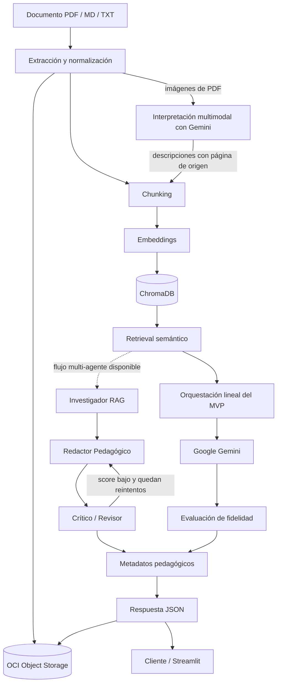

# NuevaMente

Sistema inteligente de adaptación y generación de contenido educativo desarrollado para el Hackathon ONE G10 de Oracle Next Education y Alura.

NuevaMente transforma documentación técnica en materiales didácticos adaptados al perfil de quien aprende, el formato deseado, el sector de aplicación y el nivel de detalle. El proyecto combina recuperación semántica (RAG), Google Gemini, evaluación de fidelidad y persistencia en OCI Object Storage.

## Demo

[Probar NuevaMente](https://nuevamente.sachadev.me)

El acceso requiere usuario y contraseña. Solicitá las credenciales al equipo por privado.
Consultá la [guía de acceso](deploy/oci/DEMO_ACCESS.md) para más información.

## Problema que resuelve

La documentación técnica suele asumir conocimientos previos y presentar el mismo contenido a públicos con necesidades distintas. NuevaMente permite convertir una fuente técnica en tutoriales, flashcards, cuestionarios, resúmenes ejecutivos o guiones de clase, manteniendo el contenido anclado al documento original.

El caso de uso principal pertenece al sector **EdTech**, con contextualización adicional para Fintech, Salud, Ecommerce o un dominio general.

## Funcionalidades

- Extracción y normalización de documentos PDF, Markdown y TXT.
- Segmentación, embeddings e indexación local con ChromaDB.
- Recuperación de contexto relevante antes de generar contenido.
- Adaptación mediante Google Gemini con salida estructurada.
- Flujo multi-agente seleccionable con Investigador RAG, Redactor Pedagógico y Crítico/Revisor.
- Interpretación de imágenes y diagramas técnicos embebidos en PDF con texto extraíble.
- Cinco formatos pedagógicos: Tutorial, Flashcards, Quiz, Resumen Ejecutivo y Guion de Clase.
- Evaluación de fidelidad y claridad pedagógica.
- Metadatos de aprendizaje y estimación del tiempo de estudio.
- Persistencia de documentos y resultados en OCI Object Storage.
- API REST con FastAPI y contratos validados mediante Pydantic v2.
- Interfaz Streamlit para cargar documentos y configurar la adaptación.
- Quiz interactivo con retroalimentación y avisos sobre preguntas que requieren revisión.
- Descarga en JSON, Markdown y PDF; exportación de Flashcards a CSV para Anki.
- Despliegue de FastAPI y Streamlit en OCI Compute mediante contenedores Docker.

## Arquitectura



El backend mantiene separadas las capas HTTP, los contratos y la lógica de negocio:

```text
endpoint -> servicio de adaptación -> RAG / Gemini / evaluación / metadatos
                                \-> servicio de almacenamiento -> OCI
```

El endpoint utiliza el flujo lineal por defecto (`USE_MULTIAGENT=false`). Con `USE_MOCK_LLM=false` y `USE_MULTIAGENT=true`, selecciona el servicio multi-agente de LangGraph, que reutiliza retrieval, generación y evaluación para permitir ciclos de revisión controlados. La selección del flujo depende de la configuración del entorno desplegado.

La descripción completa y los contratos de datos se encuentran en [`docs/ARCHITECTURE.md`](docs/ARCHITECTURE.md).

### Advertencias de fidelidad (NM-32)

La política se aplica en el backend, tanto al flujo lineal como al multiagente,
sin modificar el cálculo de fidelidad de NM-09.
`FIDELITY_SCORE_THRESHOLD` (por defecto `0.7`, entre 0 y 1) determina cuándo
el score queda por debajo del mínimo. Igualar el umbral no se considera estar por debajo.
Además, cualquier afirmación que el verificador marque sin respaldo requiere revisión,
aunque el score global supere ese mínimo.

El bloque `evaluacion_calidad` agrega estos campos:

| Campo | Significado |
|---|---|
| `umbral_fidelidad` | Umbral aplicado por el backend. |
| `requiere_revision` | `true` si el score está bajo el umbral o hay afirmaciones sin respaldo. |
| `afirmaciones_no_respaldadas` | Lista de `{ "item": 1, "texto": "..." }`. El índice 0 representa la introducción y 1..N la posición del item. |

Streamlit muestra el score como porcentaje con un indicador de color y texto respecto
del umbral. Los resultados observados muestran una advertencia, no una confirmación
verde de generación. En Quiz se marca visiblemente cada pregunta observada y su respuesta
se presenta como propuesta pendiente de revisión. Si solo hay un score bajo, sin detalle
por item, se advierte sobre todas las preguntas. NM-32 no agrega regeneración ni elimina
items. El flujo multiagente conserva sus ciclos de revisión de NM-28; las advertencias
se aplican al resultado final, incluso si agotó los reintentos o conserva afirmaciones
sin respaldo con un score alto. El detalle se conserva en la respuesta,
en el JSON descargable y en el paquete enviado a OCI.

Antes de indexar o generar, ambos flujos reales exigen `DOCUMENT_MIN_WORDS` palabras (por defecto
`30`, configurable con un entero positivo). Si no se alcanza, devuelve HTTP 422 con
`DOCUMENTO_INSUFICIENTE` y la interfaz pide ampliar la fuente. Es un filtro preventivo
de longitud común a los cinco formatos, no una garantía de suficiencia semántica:
superarlo no asegura que el documento permita responder cualquier pregunta.
La evaluación posterior sigue siendo necesaria y depende del verificador.

Los paquetes antiguos pueden tener los nuevos campos ausentes o nulos: se muestran
sin decisión de calidad, sin asumir un umbral ni aprobarlos. El modo mock devuelve
una evaluación sintética, no valida la suficiencia de la fuente ni llama a proveedores.

## Tecnologías principales

| Componente | Tecnología |
|---|---|
| API | FastAPI + Python 3.11+ |
| Interfaz | Streamlit |
| Validación | Pydantic v2 |
| LLM y embeddings | Google Gemini |
| Orquestación | LangChain + LangGraph, seleccionables desde el endpoint |
| Base vectorial | ChromaDB |
| Persistencia | OCI Object Storage |
| Despliegue | OCI Compute + Docker Compose + Traefik |
| Secretos en OCI | OCI Vault + Instance Principal |
| Pruebas | Pytest |

### Estado actual de los componentes

| Componente | Estado |
|---|---|
| Backend FastAPI | Implementado: ingesta, RAG, generación, fidelidad, metadatos y persistencia OCI. |
| Pipeline lineal | Integrado en `POST /api/v1/adaptar-contenido`. |
| Flujo multi-agente | Integrado en el endpoint mediante NM-28 ([#83](https://github.com/No-Country-simulation/nuevamente-g10-latam-equipo21/pull/83)), seleccionable con `USE_MULTIAGENT=true` y `USE_MOCK_LLM=false`. |
| Frontend Streamlit | Implementado y conectado a los endpoints de extracción y adaptación de FastAPI. |
| Despliegue OCI Compute | Backend, frontend y servicio de acceso saludables con el release `18f2b41`, validado el 27 de octubre de 2026 con Gemini y Object Storage reales. |
| Vínculo entre original y paquete | Integrado mediante NM-27: `documento_id` y `objeto_origen_id` se conservan en la respuesta y en el JSON persistido. |
| Contrato uniforme de errores | Integrado mediante NM-21: errores de dominio, validación, HTTP y fallos inesperados usan el sobre `status` / `error`. |
| Diagramas técnicos | NM-D4 integrado: extracción, interpretación multimodal e inclusión de las descripciones en el contexto RAG. |
| Quiz y exportaciones | NM-D3 y NM-D5 integrados: respuestas interactivas, explicación inmediata y exportación del paquete. |

## Estructura del repositorio

```text
backend/
├── app/
│   ├── api/v1/endpoints/   # Rutas HTTP
│   ├── core/               # Configuración global
│   ├── schemas/            # Contratos Pydantic
│   ├── services/           # Ingesta, RAG, Gemini y reglas de negocio
│   └── main.py             # Aplicación FastAPI
├── scripts/                # Utilidades y benchmarks
├── tests/                  # Pruebas automatizadas
├── .env.example            # Plantilla de configuración sin secretos
└── requirements.txt        # Dependencias fijadas
frontend/
├── components/              # Componentes de la interfaz Streamlit
├── services/                # Cliente HTTP para FastAPI
├── tests/                   # Pruebas del frontend
├── app.py                   # Punto de entrada de Streamlit
├── .env.example             # URL local de la API
└── requirements.txt         # Dependencias del frontend
deploy/oci/
├── compose.backend.yml      # Backend, frontend y demo_auth; acceso público mediante Traefik
├── demo_auth/               # Página de acceso y verificación de sesiones
├── DEMO_ACCESS.md           # Acceso protegido y comprobaciones
└── README.md                # Guía operativa de despliegue en OCI Compute
docs/
├── ARCHITECTURE.md          # Arquitectura y contratos oficiales
└── NM-D1_COMPARATIVA.md     # Evidencia histórica de la comparativa multiagente
```

## Requisitos

- Python 3.11 o superior.
- Git.
- Docker y Docker Compose para reproducir el despliegue en contenedores.
- Una API key de Google Gemini para probar el pipeline real.
- Una cuenta de OCI con Object Storage para probar la persistencia real.

El modo mock permite probar el contrato de adaptación sin consumir Gemini ni escribir objetos en OCI.

## Instalación local

Clonar el repositorio y entrar al backend:

```powershell
git clone https://github.com/No-Country-simulation/nuevamente-g10-latam-equipo21.git
cd nuevamente-g10-latam-equipo21/backend
```

Crear y activar un entorno virtual:

```powershell
python -m venv .venv
.\.venv\Scripts\Activate.ps1
```

En Linux o macOS, la activación equivalente es:

```bash
source .venv/bin/activate
```

Instalar las dependencias:

```powershell
python -m pip install --upgrade pip
python -m pip install -r requirements.txt
```

Crear la configuración local a partir de la plantilla:

```powershell
Copy-Item .env.example .env
```

En Linux o macOS:

```bash
cp .env.example .env
```

El archivo `.env` contiene configuración local y secretos: **nunca debe agregarse a Git**.

### Instalación del frontend

En una segunda terminal, entrar a `frontend/`, crear otro entorno virtual e
instalar sus dependencias:

```powershell
cd ..\frontend
python -m venv .venv
.\.venv\Scripts\Activate.ps1
python -m pip install --upgrade pip
python -m pip install -r requirements.txt
Copy-Item .env.example .env
```

En Linux o macOS, utilizar `source .venv/bin/activate` y
`cp .env.example .env`. La plantilla configura el acceso local a FastAPI sin
incluir secretos.

## Configuración

Las variables disponibles se encuentran en [`backend/.env.example`](backend/.env.example).

### Aplicación

| Variable | Valor de ejemplo | Uso |
|---|---|---|
| `ENVIRONMENT` | `development` | Entorno de ejecución. |
| `API_V1_STR` | `/api/v1` | Prefijo de las rutas de la API. |
| `PROJECT_NAME` | `NuevaMente API` | Nombre expuesto por FastAPI. |
| `VERSION` | `0.1.0` | Versión informativa de la API. |
| `USE_MOCK_LLM` | `true` | Activa la respuesta mock sin llamadas externas. |
| `USE_MULTIAGENT` | `false` | Selecciona el grafo multiagente cuando el modo mock está desactivado. Ambos flujos reales aplican la política de NM-32. |
| `CORS_ORIGINS` | `["http://localhost:8501"]` | Orígenes autorizados para el frontend. |

### Gemini y RAG

| Variable | Valor de ejemplo | Uso |
|---|---|---|
| `GEMINI_API_KEY` | `tu_api_key_aqui` | Credencial de Gemini; obligatoria para el pipeline real. |
| `GEMINI_MODEL_NAME` | `gemini-3.8-flash` | Modelo generativo. |
| `GEMINI_FALLBACK_MODEL_NAME` | vacío | Modelo de respaldo opcional ante cuota (429) o indisponibilidad (503); debe ser distinto del principal. |
| `GEMINI_EMBEDDING_MODEL_NAME` | `gemini-embedding-001` | Modelo de embeddings. |
| `GEMINI_TIMEOUT_SECONDS` | `30` | Tiempo máximo por llamada al proveedor. |
| `DIAGRAM_MAX_IMAGES_PER_DOCUMENT` | `10` | Máximo de imágenes interpretadas por PDF antes de rechazar la solicitud. |
| `DIAGRAM_MIN_IMAGE_AREA_PIXELS` | `10000` | Área mínima para interpretar una imagen y descartar íconos pequeños. |
| `CHROMA_PERSIST_DIRECTORY` | `./chroma_db` | Directorio local de ChromaDB. |
| `RETRIEVAL_TOP_K` | `5` | Límite de recuperación de una consulta simple; el flujo por ventanas utiliza cupos por zona. |
| `RETRIEVAL_SCORE_THRESHOLD` | `0.35` | Umbral mínimo de similitud. |
| `RETRIEVAL_MAX_CONTEXT_TOKENS` | `6000` | Presupuesto global aproximado del contexto ensamblado, incluidas sus referencias. |
| `RETRIEVAL_MAX_VENTANAS` | `10` | Máximo de zonas del documento consultadas para ampliar cobertura. |
| `RETRIEVAL_VENTANA_CHARS` | `2000` | Tamaño utilizado para calcular la cantidad de ventanas. |
| `RETRIEVAL_VENTANA_CANDIDATOS` | `8` | Mínimo de candidatos solicitados por ventana; puede crecer según su cupo. |
| `RETRIEVAL_FRAGMENTOS_POR_VENTANA` | `2` | Cupo mínimo por zona, sujeto a candidatos disponibles y al presupuesto global. |
| `FIDELITY_SCORE_THRESHOLD` | `0.7` | Umbral de fidelidad contra la fuente. |
| `DOCUMENT_MIN_WORDS` | `30` | Mínimo preventivo de palabras antes de indexar y generar en el flujo real. |
| `MULTI_AGENT_MAX_ITERATIONS` | `3` | Máximo de iteraciones Redactor-Crítico del flujo multi-agente. |

Si se configura un modelo de respaldo, `GeminiProvider` lo utiliza solo cuando el
principal falla por cuota o indisponibilidad. Los demás errores mantienen el
comportamiento anterior. Si ambos modelos fallan, la API conserva el error
`LLM_NO_DISPONIBLE`; el modelo utilizado y el motivo del cambio quedan solo en logs.

### OCI Object Storage

| Variable | Valor de ejemplo | Uso |
|---|---|---|
| `OCI_AUTH_MODE` | `api_key` | Valor de la plantilla local `.env.example`. Si no se define, el código usa `instance_principal`, recomendado en OCI Compute. |
| `OCI_NAMESPACE` | `tu_namespace_oci_aqui` | Namespace de Object Storage. |
| `OCI_BUCKET_NAME` | `nuevamente-contenidos-educativos` | Bucket privado del proyecto. |
| `OCI_REGION` | `sa-saopaulo-1` | Región de OCI. |
| `OCI_USER_OCID` | valor local | Usuario técnico para autenticación por API key. |
| `OCI_TENANCY_OCID` | valor local | Tenancy de OCI. |
| `OCI_FINGERPRINT` | valor local | Fingerprint de la clave pública. |
| `OCI_KEY_FILE` | `~/.oci/oci_api_key.pem` | Ruta local a la clave privada. |
| `OCI_KEY_PASSPHRASE` | vacío | Passphrase, si la clave privada utiliza una. |

No compartas el archivo `.env`, `~/.oci/config`, claves `.pem` ni credenciales reales.

### Validación de configuración al iniciar

Cuando `USE_MOCK_LLM=false`, el backend valida la configuración del pipeline real al arrancar. Deben estar definidas como mínimo:

- `GEMINI_API_KEY`
- `OCI_NAMESPACE`

Si alguna falta, la aplicación no inicia y el mensaje de configuración identifica la variable ausente.

`OCI_AUTH_MODE` mantiene `instance_principal` como valor predeterminado para el despliegue en OCI Compute.

Para desarrollo local con credenciales de usuario:

```dotenv
USE_MOCK_LLM=false
GEMINI_API_KEY=tu_api_key
OCI_NAMESPACE=tu_namespace
OCI_AUTH_MODE=api_key
```

Para una VM de OCI Compute:

```dotenv
USE_MOCK_LLM=false
GEMINI_API_KEY=tu_api_key
OCI_NAMESPACE=tu_namespace
OCI_AUTH_MODE=instance_principal
```

En la VM no deben copiarse `OCI_USER_OCID`, `OCI_TENANCY_OCID`, `OCI_FINGERPRINT` ni claves privadas cuando se utiliza `instance_principal`.

## Configuración de OCI Object Storage

1. Seleccionar la región donde se ejecutará el proyecto; el entorno actual utiliza São Paulo (`sa-saopaulo-1`).
2. Crear un bucket **privado** llamado `nuevamente-contenidos-educativos` o definir otro nombre mediante `OCI_BUCKET_NAME`.
3. Crear un grupo IAM para el servicio y asignarle una política limitada al bucket requerido.
4. Crear un usuario técnico, agregarlo al grupo y registrar su clave pública de API.
5. Guardar la clave privada solamente en el equipo o instancia que ejecuta el backend.
6. En local, completar `OCI_AUTH_MODE=api_key` y las variables de la credencial dentro del `.env`.
7. En OCI Compute, utilizar `OCI_AUTH_MODE=instance_principal` y dejar vacías las variables de API key.
8. Verificar permisos de carga y lectura sin otorgar acceso a otros buckets.

Para despliegues sobre una instancia de OCI debe utilizarse la autenticación mediante principal de instancia, evitando claves de usuario almacenadas en el servidor.

NM-11 proporciona la carga del documento original y del paquete generado. Su adaptador ya está conectado al pipeline integral de NM-12.

Las fallas normales de persistencia en OCI no descartan el contenido generado: el endpoint conserva HTTP 200 y devuelve `almacenamiento_oci.status_upload="error"`.

Las fallas de autenticación o autorización contra OCI se consideran errores de configuración o credenciales y se devuelven al cliente como HTTP 502 con el código `OCI_AUTENTICACION_ERROR`, sin exponer credenciales ni detalles sensibles.

## Despliegue en OCI Compute

El despliegue validado ejecuta FastAPI y Streamlit como contenedores separados.
La demo cuenta con HTTPS y autenticación mediante usuario y contraseña. El acceso
de evaluadores, las pruebas externas y la limpieza administrativa del bucket se
describen en [la guía de acceso protegido](deploy/oci/DEMO_ACCESS.md).

Traefik publica Streamlit y las rutas del servicio `demo_auth` para iniciar y
cerrar sesión. `ForwardAuth` verifica la cookie antes de servir la interfaz.
FastAPI no publica puertos en el host
ni tiene una ruta habilitada en Traefik; el frontend lo consume mediante la red
`backend_internal`. El backend también está conectado a `proxy` para tener
egreso hacia Gemini, OCI y el servicio de metadatos de Instance Principal:
esto no implica aislamiento exclusivo respecto de otros contenedores de esa
red compartida. La VM utiliza Instance Principal para acceder a Object Storage
y recuperar desde OCI Vault la clave de Gemini sin versionarla.

La construcción de imágenes, configuración de Vault, inicio de servicios,
health checks y prueba end-to-end de persistencia están documentados en
[`deploy/oci/README.md`](deploy/oci/README.md).

El 27 de octubre de 2026 se desplegó `18f2b41`, cuyo contenido coincide con el
merge final `29345a7` de `main` ([PR #105](https://github.com/No-Country-simulation/nuevamente-g10-latam-equipo21/pull/105)).
Los tres contenedores quedaron saludables. Una petición interna de prueba
Principiante/Resumen Ejecutivo generó 5 ítems con Gemini, score de anclaje `1.0`
y persistencia `completado`; una consulta independiente a OCI confirmó el JSON
con HTTP 200. Desde fuera se verificaron la redirección a `/acceso`, la página de
login con HTTP 200 y la falta de acceso público directo al puerto 8000.

El 28 de octubre se completó además el recorrido autenticado desde el navegador:
carga de un Markdown sintético de 1571 bytes, generación, descarga del JSON y
lectura independiente de ambos objetos en OCI. El original conserva sus bytes,
el paquete coincide con la descarga y mantiene correctamente `documento_id` y
`objeto_origen_id`. Se generaron 6 ítems con anclaje `1.0` y sin advertencias.

Estas pruebas no cubren documentos largos, PDF con diagramas ni failover del
modelo. La evidencia detallada y los antecedentes de NM-D2 mediante `AppTest`
se conservan en la guía de despliegue.

## Ejecución

Los comandos del backend deben ejecutarse desde `backend/`, con su entorno virtual activo.

### Modo mock

Permite comprobar el contrato HTTP sin utilizar Gemini, ChromaDB ni OCI:

```dotenv
USE_MOCK_LLM=true
```

Después de iniciar la API, puede comprobarse el modo mock desde PowerShell:

```powershell
$body = @{
    documento_titulo = "Introducción a las redes VCN"
    documento_contenido = "Una Virtual Cloud Network es una red privada y configurable dentro de Oracle Cloud Infrastructure."
    perfil_destinatario = "Principiante"
    formato_salida = "Flashcards"
    nicho_sector = "General"
    nivel_detalle = "Didactico"
} | ConvertTo-Json

Invoke-RestMethod `
    -Method Post `
    -Uri "http://127.0.0.1:8000/api/v1/adaptar-contenido" `
    -ContentType "application/json" `
    -Body $body
```

### Pipeline real

Ejecuta recuperación, Gemini, evaluación, metadatos y persistencia en OCI:

```dotenv
USE_MOCK_LLM=false
GEMINI_API_KEY=tu_api_key
OCI_AUTH_MODE=api_key
OCI_NAMESPACE=tu_namespace
```

En el pipeline real también deben completarse las variables OCI restantes descritas en la sección de configuración. Dentro de OCI Compute debe utilizarse `OCI_AUTH_MODE=instance_principal` y no deben copiarse credenciales de usuario a la instancia.

Iniciar la API en modo desarrollo:

```powershell
python -m uvicorn app.main:app --reload
```

Servicios disponibles:

- API: <http://127.0.0.1:8000>
- Estado: <http://127.0.0.1:8000/api/v1/health>
- Swagger UI: <http://127.0.0.1:8000/api/v1/docs>
- Acceso corto a Swagger: <http://127.0.0.1:8000/docs>.
- OpenAPI: <http://127.0.0.1:8000/api/v1/openapi.json>

### Frontend Streamlit

Con FastAPI en ejecución, iniciar la interfaz desde `frontend/` y con el entorno
virtual del frontend activo:

```powershell
python -m streamlit run app.py
```

La interfaz queda disponible en <http://127.0.0.1:8501> y consume por defecto
la API en `http://127.0.0.1:8000/api/v1`. La variable `API_BASE_URL` de
`frontend/.env` permite utilizar otra dirección.

### Pruebas automatizadas

Desde `backend/`, con el entorno virtual del backend activo:

```powershell
python -m pytest tests -q
```

Desde `frontend/`, con el entorno virtual del frontend activo:

```powershell
python -m pytest tests -q
```

El entorno de pruebas del frontend necesita Pytest además de sus dependencias
de ejecución (`python -m pip install pytest==9.1.1`). Para comprobar el servicio
de acceso, desde la raíz del repositorio y con las dependencias de
`deploy/oci/demo_auth/requirements.txt`, Pytest y HTTPX instalados:

```powershell
python -m pytest deploy/oci/demo_auth/test_app.py -q
```

La regresión del 27 de octubre de 2026 sobre `18f2b41`, con Python 3.12.10,
obtuvo **388 passed, 1 skipped** en backend, **113 passed** en frontend y
**5 passed** en autenticación: **506 pruebas aprobadas**. La integración real
OCI es opt-in y fue la única omitida en esa suite. Por separado se construyeron
las tres imágenes Docker y se comprobó el arranque de backend y frontend.

La prueba contra el bucket real es opt-in para evitar escrituras accidentales durante una ejecución normal:

```powershell
$env:RUN_OCI_INTEGRATION = "1"
python -m pytest tests/test_storage_oci_integration.py -v -s
Remove-Item Env:RUN_OCI_INTEGRATION
```

La política IAM del proyecto permite crear y leer objetos, pero no eliminarlos. Por ese motivo, el objeto pequeño generado por la prueba puede permanecer en el bucket y requerir limpieza manual desde una identidad administrativa.

## Uso de la API

### 1. Extraer texto de un documento

`POST /api/v1/documents/extract` recibe un archivo PDF, Markdown o TXT como `multipart/form-data`.

Ejemplo con `curl`:

```bash
curl -X POST "http://127.0.0.1:8000/api/v1/documents/extract" \
  -F "file=@documento.pdf"
```

La respuesta entrega `text`, `pages`, `metadata`, `documento_id`, `objeto_id` y
`status_upload`. Si se interpretaron imágenes, también incluye `diagramas` con
su descripción, página, índice y nombre. El frontend reenvía `text` como
`documento_contenido`, `pages` como `documento_paginas`, el identificador estable,
`objeto_id` como `objeto_origen_id` solo si la carga fue exitosa, y `diagramas`.

NM-D4 procesa imágenes embebidas de PDF con texto extraíble. Descarta imágenes
pequeñas según `DIAGRAM_MIN_IMAGE_AREA_PIXELS` y rechaza antes de consumir Gemini
los documentos que superan `DIAGRAM_MAX_IMAGES_PER_DOCUMENT` candidatos. Una
imagen inválida o cuya interpretación falla se omite y se conserva la extracción
textual. Los PDF escaneados sin texto requieren OCR y quedan fuera de alcance.

### 2. Adaptar el contenido

`POST /api/v1/adaptar-contenido` recibe texto previamente extraído y los cuatro ejes de personalización.

Request de ejemplo:

```json
{
  "documento_titulo": "Introducción a las redes VCN",
  "documento_contenido": "Una Virtual Cloud Network es una red privada y configurable dentro de Oracle Cloud Infrastructure. Sus subredes organizan los recursos. Un Internet Gateway permite la conexión a Internet cuando las rutas y las reglas de seguridad lo autorizan.",
  "perfil_destinatario": "Principiante",
  "formato_salida": "Flashcards",
  "nicho_sector": "General",
  "nivel_detalle": "Didactico"
}
```

Response de ejemplo:

```json
{
  "status": "exito",
  "metadatos": {
    "perfil_aplicado": "Principiante",
    "formato_generado": "Flashcards",
    "tiempo_estimado_estudio_minutos": 5,
    "conceptos_clave": ["VCN", "Subredes", "Internet Gateway"],
    "prerrequisitos": []
  },
  "contenido_adaptado": {
    "titulo": "Introducción a las redes VCN",
    "introduccion_contextualizada": "Estas tarjetas resumen los conceptos principales del documento.",
    "items": [
      {
        "frente": "¿Qué es una VCN?",
        "dorso": "Una red privada configurable dentro de OCI.",
        "pista_didactica": "Imagina una red aislada propia dentro de la nube."
      }
    ]
  },
  "evaluacion_calidad": {
    "anclaje_fuente_score": 0.95,
    "claridad_pedagogica": "Alta",
    "observaciones": "El contenido se encuentra respaldado por la fuente.",
    "umbral_fidelidad": 0.7,
    "requiere_revision": false,
    "afirmaciones_no_respaldadas": []
  },
  "almacenamiento_oci": {
    "documento_id": "identificador-derivado-del-texto",
    "objeto_origen_id": null,
    "bucket": "nuevamente-contenidos-educativos",
    "objeto_id": "contenido-introduccion-a-las-redes-vcn-principiante-flashcards-a1b2c3d4e5f6.json",
    "status_upload": "completado"
  }
}
```

Los identificadores del ejemplo son ilustrativos. `objeto_origen_id` queda nulo
cuando se adapta texto directo sin una carga previa; al reenviar el objeto
original de la extracción, el paquete conserva ese vínculo. La estructura
completa está descrita en [Arquitectura y contratos](docs/ARCHITECTURE.md).

Valores admitidos:

- `perfil_destinatario`: `Principiante`, `Desarrollador_Junior_SemiSenior`, `Lider_Tecnico_Arquitecto`, `Gestor_Ejecutivo_No_Tecnico`.
- `formato_salida`: `Tutorial`, `Flashcards`, `Quiz`, `Resumen_Ejecutivo`, `Guion_Clase`.
- `nicho_sector`: `Fintech`, `Salud`, `Ecommerce`, `General`.
- `nivel_detalle`: `Introductorio`, `Didactico`, `Tecnico_Profundo`.

> Con `USE_MOCK_LLM=true`, el endpoint devuelve datos de prueba respetando el contrato y no ejecuta servicios externos. Con `USE_MOCK_LLM=false`, utiliza el pipeline real y persiste el paquete generado mediante OCI Object Storage.

### Comportamiento ante errores

- Una entrada inválida devuelve HTTP 422 con `status: "error"` y el bloque `error` (`codigo`, `mensaje`).
- Un fallo del LLM o del vector store devuelve HTTP 502 sin exponer trazas ni credenciales.
- Un fallo ordinario de carga en OCI no invalida el contenido generado: devuelve HTTP 200 con `almacenamiento_oci.status_upload: "error"`. Los errores de autenticación o permisos devuelven HTTP 502 con `OCI_AUTENTICACION_ERROR`.
- Los errores quedan asociados a un identificador de petición en los logs del backend.

Ejemplo de entrada inválida:

```json
{
  "status": "error",
  "error": {
    "codigo": "ENTRADA_INVALIDA",
    "mensaje": "Campo 'perfil_destinatario': Input should be 'Principiante', 'Desarrollador_Junior_SemiSenior', 'Lider_Tecnico_Arquitecto' or 'Gestor_Ejecutivo_No_Tecnico'"
  }
}
```

## Seguridad

- No versionar `.env`, claves privadas, tokens ni archivos `.pem`.
- No incluir credenciales reales en capturas, issues, logs o pull requests.
- Utilizar usuarios técnicos y permisos de mínimo privilegio en OCI.
- Rotar inmediatamente cualquier credencial que haya sido expuesta.

## Entregas y estado de tickets

La tabla distingue lo que ya está integrado de lo aprobado o todavía pendiente. No se asignan fechas de integración a cambios que aún no ingresaron en `develop`.

Estados revisados al 27 de octubre de 2026 (UTC).

| Fecha de integración (UTC) | Ticket | Entrega | Responsable | PR o referencia | Revisión | Estado |
|---|---|---|---|---|---|---|
| 23 sep 2026 | NM-01 | Arquitectura, decisiones tecnológicas y contratos iniciales. | Alcides Perez | [Issue #7](https://github.com/No-Country-simulation/nuevamente-g10-latam-equipo21/issues/7), integrado junto con [#29](https://github.com/No-Country-simulation/nuevamente-g10-latam-equipo21/pull/29) | Equipo | Integrado |
| 25 sep 2026 | NM-02 | Configuración base de OCI Object Storage en São Paulo. | Leandro Melchiori / Alcides Perez | [#38](https://github.com/No-Country-simulation/nuevamente-g10-latam-equipo21/pull/38) | Julio Diaz | Integrado |
| 23 sep 2026 | NM-03 | Estructura inicial del backend FastAPI y gestión de configuración. | Leandro Melchiori | [#29](https://github.com/No-Country-simulation/nuevamente-g10-latam-equipo21/pull/29) | Bianca Zorio | Integrado |
| 24 y 29 sep 2026 | NM-04 | Extracción y normalización de PDF, Markdown y TXT. | Julio Diaz | [#36](https://github.com/No-Country-simulation/nuevamente-g10-latam-equipo21/pull/36), [#41](https://github.com/No-Country-simulation/nuevamente-g10-latam-equipo21/pull/41) | Leandro Melchiori | Integrado |
| 24 sep 2026 | NM-05 | Chunking, embeddings e indexación en ChromaDB. | Ever Ayala | [#35](https://github.com/No-Country-simulation/nuevamente-g10-latam-equipo21/pull/35) | Leandro Melchiori | Integrado |
| 25 sep 2026 | NM-06 | Recuperación semántica y ensamblado de contexto. | Hernan Rojas | [#34](https://github.com/No-Country-simulation/nuevamente-g10-latam-equipo21/pull/34) | Leandro Melchiori | Integrado |
| 28 sep 2026 | NM-07 | Esquemas Pydantic de entrada, salida e items polimórficos. | Jeampiero Gonzalez | [#37](https://github.com/No-Country-simulation/nuevamente-g10-latam-equipo21/pull/37) | Leandro Melchiori | Integrado |
| 29 sep 2026 | NM-08 | Proveedor Gemini, prompts y generación estructurada. | Leandro Melchiori | [#39](https://github.com/No-Country-simulation/nuevamente-g10-latam-equipo21/pull/39) | Julio Diaz | Integrado |
| 30 sep 2026 | NM-09 | Evaluación de fidelidad y anclaje contra la fuente. | Leandro Melchiori | [#40](https://github.com/No-Country-simulation/nuevamente-g10-latam-equipo21/pull/40) | Gustavo | Integrado |
| 1 oct 2026 | NM-10 | Metadatos pedagógicos y tiempo estimado de estudio. | Gustavo | [#44](https://github.com/No-Country-simulation/nuevamente-g10-latam-equipo21/pull/44), [#43](https://github.com/No-Country-simulation/nuevamente-g10-latam-equipo21/pull/43) | Leandro Melchiori | Integrado |
| 1 oct 2026 | NM-11 | Persistencia de originales y paquetes en Object Storage. | Leandro Melchiori | [#42](https://github.com/No-Country-simulation/nuevamente-g10-latam-equipo21/pull/42) | Gustavo | Integrado |
| 1 y 2 oct 2026 | NM-12 | Endpoint integral, errores tipados, trazabilidad y adaptador real de OCI. | Gustavo | [#43](https://github.com/No-Country-simulation/nuevamente-g10-latam-equipo21/pull/43), [#46](https://github.com/No-Country-simulation/nuevamente-g10-latam-equipo21/pull/46) | Leandro Melchiori | Integrado |
| 5 oct 2026 | NM-13 | Carga de documentos y selección de parámetros desde Streamlit. | Julio Diaz | [#58](https://github.com/No-Country-simulation/nuevamente-g10-latam-equipo21/pull/58) | Leandro Melchiori | Integrado |
| 5 oct 2026 | NM-14 | Visualización de los cinco formatos educativos. | Ever Ayala | [#59](https://github.com/No-Country-simulation/nuevamente-g10-latam-equipo21/pull/59) | Leandro Melchiori | Integrado |
| 8 oct 2026 | NM-15 | Descarga del paquete educativo en JSON. | Gustavo | [#61](https://github.com/No-Country-simulation/nuevamente-g10-latam-equipo21/pull/61) | Leandro Melchiori / Julio Diaz | Integrado |
| 3 y 15 oct 2026 | NM-16 | README, arquitectura, instalación y documentación del proyecto. | Leandro Melchiori | [#57](https://github.com/No-Country-simulation/nuevamente-g10-latam-equipo21/pull/57), [#65](https://github.com/No-Country-simulation/nuevamente-g10-latam-equipo21/pull/65) | Gustavo / Ever Ayala | Integrado |
| — | NM-17 | Tres escenarios y guion de demostración. | Bianca Zorio | [Issue #23](https://github.com/No-Country-simulation/nuevamente-g10-latam-equipo21/issues/23) | — | Ticket cerrado; pendiente de enlazar las evidencias de demo |
| 29 sep 2026 | NM-18 | Endpoint mock para desbloquear el frontend. | Gustavo | [#33](https://github.com/No-Country-simulation/nuevamente-g10-latam-equipo21/pull/33) | Leandro Melchiori | Integrado |
| 7 y 8 oct 2026 | NM-19 | Estado de sesión y conservación del resultado en Streamlit. | Julio Diaz | [#66](https://github.com/No-Country-simulation/nuevamente-g10-latam-equipo21/pull/66), [#68](https://github.com/No-Country-simulation/nuevamente-g10-latam-equipo21/pull/68) | Leandro Melchiori | Integrado |
| 3 oct 2026 | NM-20 | Corrección del estado de persistencia informado por el mock. | Gustavo | [#56](https://github.com/No-Country-simulation/nuevamente-g10-latam-equipo21/pull/56) | Leandro Melchiori | Integrado |
| 19 oct 2026 | NM-21 | Contrato uniforme de errores en todos los endpoints. | Hernan Rojas | [#84](https://github.com/No-Country-simulation/nuevamente-g10-latam-equipo21/pull/84) | Leandro Melchiori / Ever Ayala | Integrado |
| 8 oct 2026 | NM-22 | Recuperación de documentos largos por ventanas. | Gustavo | [#63](https://github.com/No-Country-simulation/nuevamente-g10-latam-equipo21/pull/63), [#69](https://github.com/No-Country-simulation/nuevamente-g10-latam-equipo21/pull/69) | Leandro Melchiori / Ever Ayala | Integrado |
| 8 oct 2026 | NM-23 | Trazabilidad de la página de origen. | Hernan Rojas | [#62](https://github.com/No-Country-simulation/nuevamente-g10-latam-equipo21/pull/62) | Leandro Melchiori | Integrado |
| 8 oct 2026 | NM-24 | Tipado estricto y validación de items según formato. | Leandro Melchiori | [#64](https://github.com/No-Country-simulation/nuevamente-g10-latam-equipo21/pull/64) | Hernan Rojas | Integrado |
| 8 oct 2026 | NM-25 | Validación de configuración y protección de credenciales. | Ever Ayala | [#67](https://github.com/No-Country-simulation/nuevamente-g10-latam-equipo21/pull/67) | Leandro Melchiori | Integrado |
| 19 y 27 oct 2026 | NM-26 | Integración de `develop` en `main`, tag y limpieza de ramas. | Leandro Melchiori | [#88](https://github.com/No-Country-simulation/nuevamente-g10-latam-equipo21/pull/88), release final [#105](https://github.com/No-Country-simulation/nuevamente-g10-latam-equipo21/pull/105) | Ever Ayala | Release final integrado en `main`; tag y limpieza de la última rama integrada pendientes |
| 25 oct 2026 | NM-27 | Persistencia end-to-end y vínculo entre original y paquete. | Miguel Acosta | [#70](https://github.com/No-Country-simulation/nuevamente-g10-latam-equipo21/pull/70) | Leandro Melchiori | Integrado |
| 16 oct 2026 | NM-28 | Exposición del flujo multiagente desde el endpoint. | Gustavo | [#83](https://github.com/No-Country-simulation/nuevamente-g10-latam-equipo21/pull/83) | Ever Ayala | Integrado |
| 19 oct 2026 | NM-29 | Procesamiento de embeddings en lotes de hasta 100 fragmentos. | Ever Ayala | [#87](https://github.com/No-Country-simulation/nuevamente-g10-latam-equipo21/pull/87) | Leandro Melchiori | Integrado |
| 23 oct 2026 | NM-30 | Errores controlados, nombres originales y validación de documentos vacíos. | Ever Ayala | [#98](https://github.com/No-Country-simulation/nuevamente-g10-latam-equipo21/pull/98) | Leandro Melchiori | Integrado |
| 22 oct 2026 | NM-31 | Tema claro consistente y texto legible en los componentes de Streamlit. | Gustavo | [#103](https://github.com/No-Country-simulation/nuevamente-g10-latam-equipo21/pull/103) | Ever Ayala / Leandro Melchiori | Integrado |
| 22 oct 2026 | NM-32 | Advertencias de fidelidad y contenido sin respaldo documental. | Leandro Melchiori | [#90](https://github.com/No-Country-simulation/nuevamente-g10-latam-equipo21/pull/90) | Ever Ayala | Integrado |
| 24 oct 2026 | NM-33 | Cobertura completa del documento, cantidad de ítems y conceptos clave respaldados. | Gustavo | [#91](https://github.com/No-Country-simulation/nuevamente-g10-latam-equipo21/pull/91) | Ever Ayala / Leandro Melchiori | Integrado |
| 16 oct 2026 | NM-34 | Prompts con impacto de negocio respaldado y registro de idioma consistente. | Gustavo | [#85](https://github.com/No-Country-simulation/nuevamente-g10-latam-equipo21/pull/85) | Ever Ayala | Integrado |
| 24 oct 2026 | NM-35 | Coherencia del resultado con el archivo y los parámetros actuales. | Alcides Perez | [#101](https://github.com/No-Country-simulation/nuevamente-g10-latam-equipo21/pull/101) | Leandro Melchiori | Integrado |
| 24 oct 2026 | NM-36 | Errores amigables, validación temprana y espera informada. | Miguel Acosta | [#102](https://github.com/No-Country-simulation/nuevamente-g10-latam-equipo21/pull/102) | Ever Ayala / Leandro Melchiori | Integrado |
| 19 oct 2026 | NM-37 | Prerrequisitos visibles en el paquete educativo. | Gustavo | [#92](https://github.com/No-Country-simulation/nuevamente-g10-latam-equipo21/pull/92) | Leandro Melchiori / Ever Ayala | Integrado |
| 19 oct 2026 | NM-38 | Estado de la API en el pie, sin exponer su URL. | Hernan Rojas | [#86](https://github.com/No-Country-simulation/nuevamente-g10-latam-equipo21/pull/86) | Leandro Melchiori / Ever Ayala | Integrado |
| 19 oct 2026 | NM-39 | Protección de la demo con HTTPS y autenticación. | Leandro Melchiori | [#93](https://github.com/No-Country-simulation/nuevamente-g10-latam-equipo21/pull/93) | Ever Ayala | Integrado |
| 20 oct 2026 | NM-40 | Modelo de respaldo para Gemini ante cuota o indisponibilidad. | Leandro Melchiori | [#100](https://github.com/No-Country-simulation/nuevamente-g10-latam-equipo21/pull/100) | Ever Ayala | Integrado |
| 22 oct 2026 | NM-41 | Cierre de sesión seguro desde la interfaz desplegada. | Hernan Rojas | [#99](https://github.com/No-Country-simulation/nuevamente-g10-latam-equipo21/pull/99) | Leandro Melchiori / Ever Ayala | Integrado |
| 1 oct 2026 | NM-D1 | Flujo multiagente con Investigador, Redactor y Crítico. | Ever Ayala | [#45](https://github.com/No-Country-simulation/nuevamente-g10-latam-equipo21/pull/45) | Leandro Melchiori | Integrado |
| 14 oct 2026 | NM-D2 | Despliegue de Streamlit y FastAPI en OCI Compute. | Leandro Melchiori | [#60](https://github.com/No-Country-simulation/nuevamente-g10-latam-equipo21/pull/60) | Gustavo / Ever Ayala | Integrado |
| 23 oct 2026 | NM-D3 | Quiz interactivo con retroalimentación inmediata. | Julio Diaz | [#89](https://github.com/No-Country-simulation/nuevamente-g10-latam-equipo21/pull/89) | Ever Ayala / Leandro Melchiori | Integrado |
| 27 oct 2026 | NM-D4 | Interpretación de diagramas técnicos. | Jeampiero Gonzalez | [Issue #27](https://github.com/No-Country-simulation/nuevamente-g10-latam-equipo21/issues/27), [#82](https://github.com/No-Country-simulation/nuevamente-g10-latam-equipo21/pull/82), [#104](https://github.com/No-Country-simulation/nuevamente-g10-latam-equipo21/pull/104) | Ever Ayala / Gustavo | Integrado; #104 reemplaza #82 |
| 20 oct 2026 | NM-D5 | Exportación a Markdown, PDF y CSV para Anki. | Hernan Rojas | [#97](https://github.com/No-Country-simulation/nuevamente-g10-latam-equipo21/pull/97) | Leandro Melchiori / Ever Ayala | Integrado |

Las ramas de funcionalidad se crean desde `develop` con el formato `feature/NM-XX-descripcion`. Los cambios ingresan mediante pull request y requieren la revisión de otro integrante. Consulta [`CONTRIBUTING.md`](CONTRIBUTING.md), el [historial de `develop`](https://github.com/No-Country-simulation/nuevamente-g10-latam-equipo21/commits/develop/) y la vista de [contribuidores](https://github.com/No-Country-simulation/nuevamente-g10-latam-equipo21/graphs/contributors) para auditar la información.

## Documentación adicional

- [Arquitectura y contratos](docs/ARCHITECTURE.md)
- [Despliegue en OCI Compute](deploy/oci/README.md)
- [Guía de contribución](CONTRIBUTING.md)
