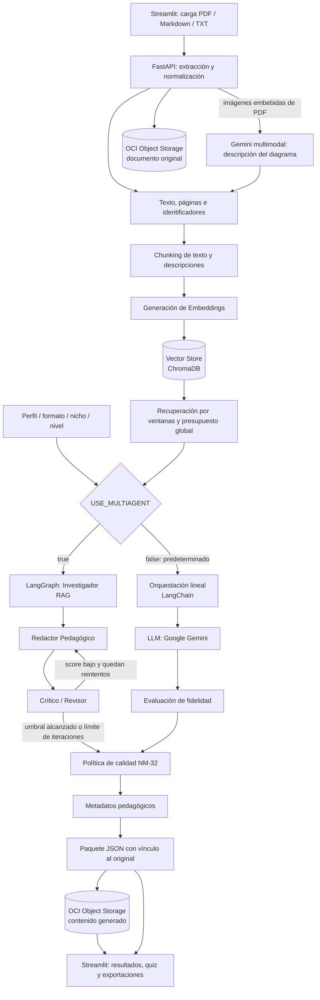

# Arquitectura de la solución y contratos de datos

**Proyecto:** NuevaMente — Sistema Inteligente de Adaptación y Generación de Contenido Educativo
**Origen:** NM-01 y ampliaciones posteriores del equipo
**Estado:** Release final integrado en `main` mediante [#105](https://github.com/No-Country-simulation/nuevamente-g10-latam-equipo21/pull/105)
**Revisión documental:** 27 de octubre de 2026, sobre `develop` `18f2b41` y su merge `29345a7` en `main` (mismo contenido).

> Este documento registra las decisiones técnicas transversales y el contrato compartido por el
> backend y sus consumidores. También refleja el estado real de implementación alcanzado por los
> tickets posteriores a NM-01.

---

## 1. Diagrama de arquitectura (flujo RAG + Agentes)



**Flujo resumido:** ingesta → chunking → embeddings → vector store → recuperación (retrieval) →
orquestación LLM → evaluación de fidelidad → generación de metadatos → persistencia en OCI →
respuesta JSON. `POST /api/v1/adaptar-contenido` selecciona el flujo lineal por defecto
o el grafo de LangGraph con `USE_MULTIAGENT=true`. Ambos requieren `USE_MOCK_LLM=false`
para ejecutar proveedores reales. El modo mock tiene prioridad, devuelve datos sintéticos
y no ejecuta RAG, generación ni persistencia del paquete. La extracción es otro endpoint
y conserva sus propias operaciones de almacenamiento e interpretación de imágenes.

En el endpoint multiagente, el contexto se recupera antes de invocar el grafo; el nodo
Investigador reutiliza ese contexto. Los dos flujos aplican al resultado final la política
de NM-32: superar el umbral de score no elimina una advertencia por afirmaciones sin respaldo.

En OCI hay tres servicios: FastAPI, Streamlit y `demo_auth`. Traefik publica la interfaz
y las rutas `/acceso` y `/salir`; consulta `/verificar` mediante `ForwardAuth` para validar
la cookie de sesión. FastAPI no publica puertos en el host ni tiene ruta en Traefik.
Streamlit lo consume por `backend_internal`; FastAPI también pertenece a `proxy` para
egreso hacia Gemini, OCI y metadatos de Instance Principal. Esa red compartida no garantiza
aislamiento exclusivo entre frontend y backend. La topología y las operaciones se detallan
en [Despliegue OCI](../deploy/oci/README.md) y [Acceso a la demo](../deploy/oci/DEMO_ACCESS.md).

---

## 2. Decisiones técnicas y justificación

| Decisión | Elección | Justificación |
|---|---|---|
| **LLM** | **Google Gemini** | Generación estructurada, evaluación e interpretación multimodal. El proveedor se mantiene desacoplado de los endpoints. Modelo, timeout y respaldo ante 429/503 son configurables; disponibilidad y cuotas dependen de la cuenta. |
| **Vector Store** | **ChromaDB** | Embebido (no requiere levantar infraestructura aparte, corre local o en la misma instancia), integración directa con LangChain, suficiente para el volumen de un MVP de hackathon. FAISS queda como alternativa si el equipo necesita más performance más adelante. |
| **Framework de orquestación** | **LangChain + LangGraph** | Flujo lineal predeterminado y flujo multiagente integrado mediante NM-28. LangGraph implementa Investigador RAG, Redactor Pedagógico y Crítico/Revisor con un máximo de `MULTI_AGENT_MAX_ITERATIONS=3` iteraciones. |
| **Stack de interfaz** | **FastAPI (backend) + Streamlit (frontend)** | FastAPI expone la API REST y valida los contratos mediante Pydantic. Streamlit permite cargar documentos, seleccionar los ejes de adaptación y consumir la API sin acoplar lógica de negocio a la interfaz. |
| **Persistencia** | **OCI Object Storage** (obligatorio) | Bucket privado para originales y paquetes JSON. NM-27 conserva `documento_id` y `objeto_origen_id` en respuesta y objeto persistido; nombres deterministas permiten sobrescribir el paquete para la misma entrada. |
| **Despliegue** | **OCI Compute + Docker Compose + Traefik** | Tres contenedores con usuarios sin privilegios, filesystem de solo lectura y health checks. Traefik protege Streamlit mediante el servicio `demo_auth`. La VM accede a Vault y Object Storage mediante Instance Principal. |

---

## 3. Contrato JSON de entrada

`POST /api/v1/documents/extract` recibe `multipart/form-data` con un campo `file`
PDF, Markdown o TXT. Devuelve `text`, `pages`, `metadata`, `documento_id`,
`objeto_id`, `status_upload` y, cuando existen interpretaciones exitosas, `diagramas`.

`POST /api/v1/adaptar-contenido` recibe JSON. Ejemplo con los campos opcionales
de trazabilidad y diagramas; sus identificadores son ilustrativos:

```json
{
  "documento_id": "identificador-derivado-del-texto",
  "objeto_origen_id": "originales/hash-redes.pdf",
  "documento_titulo": "Introducción a las redes VCN",
  "documento_contenido": "Una Virtual Cloud Network es una red privada y configurable dentro de Oracle Cloud Infrastructure. Sus subredes organizan los recursos. Un Internet Gateway permite la conexión a Internet cuando las rutas y las reglas de seguridad lo autorizan.",
  "documento_paginas": [
    {
      "page_number": 1,
      "text": "Una Virtual Cloud Network es una red privada y configurable dentro de Oracle Cloud Infrastructure. Sus subredes organizan los recursos. Un Internet Gateway permite la conexión a Internet cuando las rutas y las reglas de seguridad lo autorizan."
    }
  ],
  "diagramas": [
    {
      "description": "Una VCN contiene subredes y conecta sus rutas al Internet Gateway.",
      "page_number": 1,
      "image_index": 1,
      "image_name": "red-vcn.png"
    }
  ],
  "perfil_destinatario": "Principiante",
  "formato_salida": "Flashcards",
  "nicho_sector": "General",
  "nivel_detalle": "Didactico"
}
```

### Valores permitidos por campo

| Campo | Tipo | Valores permitidos |
|---|---|---|
| `documento_titulo` | string estricto | Título del documento, mínimo 3 caracteres |
| `documento_contenido` | string estricto | Texto extraído, mínimo 10 caracteres; el pipeline real exige además `DOCUMENT_MIN_WORDS=30` palabras antes de indexar |
| `perfil_destinatario` | enum | `"Principiante"` \| `"Desarrollador_Junior_SemiSenior"` \| `"Lider_Tecnico_Arquitecto"` \| `"Gestor_Ejecutivo_No_Tecnico"` |
| `formato_salida` | enum | `"Tutorial"` \| `"Flashcards"` \| `"Quiz"` \| `"Resumen_Ejecutivo"` \| `"Guion_Clase"` |
| `nicho_sector` | enum | `"Fintech"` \| `"Salud"` \| `"Ecommerce"` \| `"General"` |
| `nivel_detalle` | enum | `"Introductorio"` \| `"Didactico"` \| `"Tecnico_Profundo"` |

> Nota: los valores enum usan exactamente los identificadores publicados en este contrato, sin
> espacios ni acentos. El frontend puede mapearlos a etiquetas legibles sin cambiar el valor que
> intercambia con la API.

> `documento_paginas` (opcional, NM-23): lista de páginas del documento de origen
> (`{"page_number": number, "text": string}`, 1-indexadas). Cuando se envía, cada fragmento
> indexado conserva su página real y la respuesta puede citarla; si se omite, todo el texto se
> indexa como página 1 (comportamiento previo). El endpoint `POST /api/v1/documents/extract` ya
> devuelve `pages` con este formato para que el cliente pueda reenviarlas.
> `POST /api/v1/documents/extract` también devuelve un `documento_id` estable derivado del
> texto extraído y el `objeto_id` original cuando se pudo persistir; el cliente los reenvía como
> `documento_id` y `objeto_origen_id` al solicitar la adaptación. Solo debe reenviar la clave
> original si `status_upload="completado"`; en caso contrario usa `null`. Si se adapta texto
> directo, los identificadores pueden omitirse y el backend deriva `documento_id` del texto.

`diagramas` es opcional y su valor predeterminado es `[]`. Cada descripción debe tener
entre 1 y 4000 caracteres; `page_number` e `image_index` son enteros desde 1 y
`image_name` no puede estar vacío. La interpretación de imágenes embebidas aplica a PDF
con texto extraíble, no a OCR. Se filtran imágenes de área conocida menor a
`DIAGRAM_MIN_IMAGE_AREA_PIXELS=10000`; las de dimensiones desconocidas siguen siendo
candidatas. Más de `DIAGRAM_MAX_IMAGES_PER_DOCUMENT=10` candidatos devuelve HTTP 400
`DOCUMENTO_INVALIDO` antes de invocar el análisis multimodal. Imágenes inválidas o cuya
interpretación falla se omiten conservando el texto y las demás interpretaciones.

Cada candidato interpretado consume una llamada multimodal adicional con
`GEMINI_TIMEOUT_SECONDS`. Las descripciones se indexan como chunks `source_type="diagram"`
con página y datos de imagen. La identidad del índice incorpora las descripciones para
evitar reutilizar un índice de solo texto al cargar un documento que contiene diagramas.

---

## 4. Contrato JSON de salida

Respuesta de adaptación exitosa (HTTP 200). Los valores ilustran el contrato;
no representan una medición de calidad:

```json
{
  "status": "exito",
  "metadatos": {
    "perfil_aplicado": "Principiante",
    "formato_generado": "Flashcards",
    "tiempo_estimado_estudio_minutos": 5,
    "conceptos_clave": ["VCN", "Subredes", "Internet Gateway"],
    "prerrequisitos": []
  },
  "contenido_adaptado": {
    "titulo": "Introducción a las redes VCN",
    "introduccion_contextualizada": "Estas tarjetas resumen la fuente.",
    "items": [
      {
        "frente": "¿Qué es una VCN?",
        "dorso": "Una red privada configurable dentro de OCI.",
        "pista_didactica": "Pensá en una red propia dentro de la nube."
      }
    ]
  },
  "evaluacion_calidad": {
    "anclaje_fuente_score": 0.95,
    "claridad_pedagogica": "Alta",
    "observaciones": "Contenido respaldado por la fuente.",
    "umbral_fidelidad": 0.7,
    "requiere_revision": false,
    "afirmaciones_no_respaldadas": []
  },
  "almacenamiento_oci": {
    "documento_id": "identificador-derivado-del-texto",
    "objeto_origen_id": "originales/hash-redes.pdf",
    "bucket": "nuevamente-contenidos-educativos",
    "objeto_id": "contenido-redes-principiante-flashcards-hash.json",
    "status_upload": "completado"
  }
}
```

`status_upload` admite `completado` o `error`. Solo el primero confirma persistencia;
un nombre en `objeto_id` no demuestra una carga exitosa. El vínculo al original se
conserva en la respuesta y en el JSON persistido. Los nombres de paquetes son
deterministas según la entrada completa: repetirla sobrescribe el mismo objeto.

`requiere_revision` es verdadero si el score es menor que `umbral_fidelidad` o el
verificador informa afirmaciones sin respaldo. Cada observación tiene la forma
`{"item": 1, "texto": "afirmación observada"}`: 0 identifica la introducción y 1..N
el ítem. Los paquetes antiguos pueden omitir estos campos o tener valores nulos
para umbral y decisión; la interfaz no los interpreta como aprobados.

Los errores del backend usan un sobre independiente, uniforme desde NM-21:

```json
{
  "status": "error",
  "error": {
    "codigo": "string",
    "mensaje": "string"
  }
}
```

| HTTP | Casos principales |
|---|---|
| 400 | `FORMATO_NO_SOPORTADO`, `PDF_SIN_TEXTO`, `DOCUMENTO_INVALIDO` |
| 422 | `ENTRADA_INVALIDA`, `DOCUMENTO_INSUFICIENTE`, `SIN_CONTEXTO_RELEVANTE`, `CONTENIDO_INSUFICIENTE` |
| 502 | `LLM_NO_DISPONIBLE`, `VECTOR_STORE_NO_DISPONIBLE`, `OCI_AUTENTICACION_ERROR` |
| 404 / 405 | `NO_ENCONTRADO` / `METODO_NO_PERMITIDO` |
| 500 | `ERROR_INTERNO`, sin detalles internos en la respuesta |

Una falla ordinaria de carga OCI conserva HTTP 200 y `status_upload="error"` para
no perder el contenido generado. Los fallos de autenticación o permisos OCI se
devuelven como HTTP 502. Los logs permiten correlacionar errores por petición sin
exponer el documento ni credenciales.

---

## 5. Estructura de `contenido_adaptado.items` según `formato_salida`

El array `items` cambia de forma según el formato pedagógico solicitado. Todos los formatos
comparten `contenido_adaptado.titulo` e `introduccion_contextualizada`; lo que varía es el
contenido de cada item.

### Flashcards

```json
{ "frente": "string", "dorso": "string", "pista_didactica": "string" }
```

### Quiz

```json
{
  "pregunta": "string",
  "opciones": ["string", "string", "string", "string"],
  "respuesta_correcta": "string",
  "justificacion": "string"
}
```

### Tutorial (Guía Paso a Paso)

```json
{
  "paso_numero": 1,
  "titulo_paso": "string",
  "contenido": "string",
  "codigo_ejemplo": null
}
```

### Resumen Ejecutivo (TL;DR)

```json
{
  "punto_clave": "string",
  "descripcion": "string",
  "impacto_negocio": "string"
}
```

### Guion de Clase / Video

```json
{
  "seccion": "string",
  "tiempo_estimado_minutos": 5,
  "narracion": "string",
  "notas_visuales": null
}
```

Los cinco casos están implementados como schemas Pydantic separados (`FlashcardItem`,
`QuizItem`, `TutorialItem`, `ResumenItem`, `GuionItem`). `OutputSchema` valida que todos
los ítems correspondan a `metadatos.formato_generado`. `QuizItem` exige al menos dos
opciones; las cuatro mostradas son un ejemplo, no una restricción del esquema.
`codigo_ejemplo` y `notas_visuales` aceptan texto o `null` y pueden omitirse.

---

## 5.1 Selección de contexto para la generación (NM-22 / NM-33 / NM-D4)

Hasta `RETRIEVAL_VENTANA_CHARS=2000` caracteres se usa una consulta con el título y
los primeros 500 caracteres, limitada por `RETRIEVAL_TOP_K=5`. En documentos más
largos se calculan hasta `RETRIEVAL_MAX_VENTANAS=10` secciones contiguas, cada una
con su propia consulta. El índice se reutiliza cuando ya contiene el documento,
evitando volver a generar sus embeddings.

Por ventana se solicitan al menos `RETRIEVAL_VENTANA_CANDIDATOS=8` candidatos y se
conserva un cupo de al menos `RETRIEVAL_FRAGMENTOS_POR_VENTANA=2`, que puede crecer
según la cantidad de chunks por zona. Se filtran por rango de `chunk_index` para
evitar que todas las ventanas aporten fragmentos del comienzo. Los diagramas
recuperados forman una zona semántica independiente de esos rangos de texto.

La selección se reparte por rondas entre zonas, elimina duplicados y comprueba
un presupuesto global aproximado de `RETRIEVAL_MAX_CONTEXT_TOKENS=6000`, incluidas
las referencias. El contexto final queda ordenado por índice de chunk y las
fuentes internas corresponden solo a fragmentos incluidos. `RETRIEVAL_TOP_K` no
es un límite global de cinco fragmentos para este recorrido por ventanas.

El contexto sigue acotado y no garantiza recuperar todo el documento: las
consultas representan cada ventana por sus primeros 500 caracteres y la
correspondencia entre caracteres, páginas y rangos de chunks es aproximada.
Las ventanas aumentan las consultas de embeddings; el verificador de fidelidad
puede realizar sus propias búsquedas. Reranking e indexación híbrida siguen
fuera del alcance del release.

## 5.2 Presentación y exportaciones

Streamlit conserva el resultado de la última generación exitosa junto con el
archivo y una copia de los parámetros aplicados (NM-19/NM-35). Un cambio de
archivo o una generación fallida limpia el resultado anterior; los cambios de
opciones no alteran los parámetros que se muestran como aplicados al paquete.

NM-D3 permite responder el quiz y ver la justificación. NM-32 advierte sobre
preguntas observadas o sobre todo el quiz si el score es bajo sin detalle por
ítem. NM-D5 exporta JSON, Markdown y PDF; CSV para Anki aplica solo a Flashcards.
La interfaz muestra también prerrequisitos, avisos de calidad y el estado de
conexión, y permite cerrar la sesión de la demo mediante `/salir`.

---

## 6. Convención de ramas y commits

**Ramas**

- `main` → siempre desplegable/estable.
- `develop` → integración de features antes de pasar a `main`.
- `feature/NM-XX-descripcion-corta` → una rama por ticket (ej. `feature/NM-05-pipeline-rag`).
- `fix/NM-XX-descripcion-corta` → correcciones puntuales.

**Commits (Conventional Commits)**

```
feat(NM-05): implementar pipeline de chunking y embeddings
fix(NM-07): corregir validación de enum en perfil_destinatario
docs(NM-01): publicar contrato JSON y diagrama de arquitectura
chore: actualizar dependencias
```
Prefijos: `feat`, `fix`, `docs`, `chore`, `test`, `refactor`.

**Pull Requests**

- Toda rama `feature/*` o `fix/*` se mergea a `develop` vía PR.
- Mínimo 1 revisión de otro integrante antes de mergear.
- El PR debe referenciar el ticket; para cerrar una issue en GitHub usar su número
  real (por ejemplo `Closes #7`), además del identificador NM que corresponda.

---

## Estado de implementación

- [x] Arquitectura y contratos aprobados por el equipo.
- [x] Backend FastAPI y contratos Pydantic implementados.
- [x] Pipeline RAG lineal con Gemini, evaluación de fidelidad y metadatos implementado.
- [x] Persistencia de documentos y paquetes generados integrada con OCI Object Storage.
- [x] Flujo multi-agente con LangGraph implementado y seleccionable desde el endpoint: NM-28, integrado mediante [#83](https://github.com/No-Country-simulation/nuevamente-g10-latam-equipo21/pull/83).
- [x] Frontend Streamlit conectado al contrato de la API.
- [x] Backend, frontend y autenticación desplegados en OCI con imágenes `develop-18f2b41` el 27 de octubre de 2026. Generación breve contra Gemini y persistencia real del JSON comprobadas; acceso HTTPS público validado por separado.
- [x] Vínculo persistente entre original y paquete (NM-27, [#70](https://github.com/No-Country-simulation/nuevamente-g10-latam-equipo21/pull/70)).
- [x] Contrato uniforme de errores (NM-21, [#84](https://github.com/No-Country-simulation/nuevamente-g10-latam-equipo21/pull/84)).
- [x] Ticket de demostración NM-17 cerrado en GitHub ([#23](https://github.com/No-Country-simulation/nuevamente-g10-latam-equipo21/issues/23)).
- [ ] Enlazar y verificar las evidencias de NM-17: documento fuente, tres JSON, guion y ensayo. El cierre del ticket no confirma por sí solo su disponibilidad en el repositorio.
- [x] Release final integrado en `main` mediante [#105](https://github.com/No-Country-simulation/nuevamente-g10-latam-equipo21/pull/105).
- [x] Quiz interactivo NM-D3 ([#89](https://github.com/No-Country-simulation/nuevamente-g10-latam-equipo21/pull/89)).
- [x] Interpretación de diagramas NM-D4 ([#104](https://github.com/No-Country-simulation/nuevamente-g10-latam-equipo21/pull/104), que reemplaza [#82](https://github.com/No-Country-simulation/nuevamente-g10-latam-equipo21/pull/82)).
- [x] Exportaciones Markdown, PDF y CSV para Anki NM-D5 ([#97](https://github.com/No-Country-simulation/nuevamente-g10-latam-equipo21/pull/97)).
- [x] Regresión del release: 388 pruebas backend, 113 frontend y 5 autenticación aprobadas (506 en total); una integración OCI omitida en la suite local y prueba real de persistencia ejecutada por separado.
- [ ] Crear el tag de release y completar la limpieza de la última rama remota integrada (NM-26).

El 28 de octubre se comprobó adicionalmente NM-27 desde el navegador autenticado:
carga de un archivo Markdown, generación, descarga y comparación del paquete
con el JSON persistido, verificando también la integridad y el vínculo al original
en OCI. Estas pruebas no cubren documentos largos, PDF con diagramas ni failover
del modelo en la VM. Las evidencias históricas y el alcance de cada comprobación se conservan en
[la guía de despliegue](../deploy/oci/README.md).
